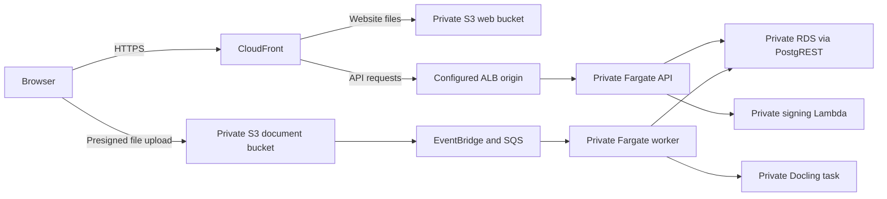

# Cortéx frontend

Cortéx is SolluCIO's document-grounded chat application. This repository contains the browser interface: sign-in and password recovery, chat and citations, temporary attachments, the document library, and role-based settings and administration.

**The AWS frontend is a Next.js static export hosted in private S3 and delivered through CloudFront.** React runs in the browser. The API, document worker and Docling parser run in the separate [backend repository](https://github.com/cortex-ai-core/cortex-mvp/tree/dev) on ECS/Fargate.

[Open Oregon Dev](https://cortex-dev.solluciopartners.com/) using your individual Cortéx account. Its GoDaddy CNAME and HTTPS website/API health were verified on October 19, 2026. The [generated CloudFront address](https://d3ni3zlrnsq9j7.cloudfront.net/) remains usable.

## Contents

- [Run locally](#run-locally)
- [Configuration](#configuration)
- [How the code works](#how-the-code-works)
- [Code map](#code-map)
- [Where it runs in AWS](#where-it-runs-in-aws)
- [Deployment and recovery](#deployment-and-recovery)
- [Verification and troubleshooting](#verification-and-troubleshooting)
- [Related documentation](#related-documentation)

## Run locally

Use **Node.js 24** and npm, matching GitHub Actions. Use the `dev` branch for the AWS application. Run `npm ci` after cloning or changing the lockfile.

### Frontend with an already-running local backend

From this repository's root:

```bash
npm ci
NEXT_PUBLIC_BACKEND_URL=http://localhost:8082 \
NEXT_PUBLIC_DIRECT_UPLOAD=false \
CORTEX_NEXT_DIST_DIR=.next-local \
  npm run dev -- --port 3003
```

Open **http://localhost:3003**. The current combined backend local environment listens on **8082**. The frontend alone does not start the API, database or parser, and does not provision a login account. Point it at the backend you have actually started.

The frontend can live in any folder or IDE workspace when started this way. Its connection to the backend is the URL, not a filesystem import. No AWS access keys, Cognito client secret or OpenAI key are needed in the frontend.

### Recommended: start both repositories together

The backend's `dev:local` launcher starts the local containers, API and this frontend. Install AWS CLI v2 and start Docker Desktop before running backend setup. It expects sibling folders with these names; the parent folder can have any name, and the IDE workspaces can be separate:

```text
any-parent-folder/
├── cortex-mvp/
└── cortex-ui-mvp/
```

If cloning fresh:

```bash
git clone --branch dev https://github.com/cortex-ai-core/cortex-mvp.git
git clone --branch dev https://github.com/cortex-ai-core/cortex-ui-mvp.git
cd cortex-mvp
npm ci
npm ci --prefix ../cortex-ui-mvp
```

From the **backend** root, select the SolluCIO Dev SSO profile and prepare the synthetic local environment:

```bash
unset AWS_ACCESS_KEY_ID AWS_SECRET_ACCESS_KEY AWS_SESSION_TOKEN
export AWS_PROFILE=cortex-dev
export AWS_REGION=us-west-2
aws sso login --profile cortex-dev
aws sts get-caller-identity --query Account --output text
npm run setup:local -- --email YOUR_EXISTING_OREGON_COGNITO_EMAIL
```

STS must return **909762691423**. Use your enabled, verified Oregon Dev account's email; it links the synthetic local user to that identity. This command does not ask you to put a password in source or create a new cloud user. AWS CLI access is needed for backend setup, not for rendering this frontend.

Docker Desktop must be running. For parsing, build the backend's local Docling image once if it is not already available:

```bash
docker build -t cortex-parser:aws-local parser
npm run dev:local -- --documents
```

`--documents` enables the local parser container. It does not select or upload documents. The parser build can take time and needs memory for its models. For backend prerequisites, SSO setup and generated secret files, follow the [backend local setup](https://github.com/cortex-ai-core/cortex-mvp/blob/dev/README.md#start-locally).

| Local component | Address / port |
| --- | --- |
| Frontend | `http://localhost:3003` |
| Fastify API | `http://localhost:8082` |
| PostgREST database interface | `http://localhost:3004` |
| PostgreSQL | `127.0.0.1:5433` |
| Docling parser, with `--documents` | `http://localhost:8091` |

The local database contains synthetic fixtures, not a copy of the customer dataset. Files use local storage and the backend's local ingestion worker. Cognito and OpenAI remain cloud dependencies, so full local testing is not offline. Local uploads do not exercise S3/EventBridge/SQS.

Press **Ctrl+C** to stop the combined API/frontend processes. From the backend, `npm run stop:local` stops the containers while preserving their data volumes. Ohio has been retired; the original Ohio connection scripts are obsolete.

## Configuration

[lib/backend.ts](lib/backend.ts) is the shared API-base definition used by the active AWS screens. Public frontend values are read by Next.js during development/build and become browser-visible JavaScript. Changing them after uploading a static build requires rebuilding and republishing.

| Variable | Local combined environment | AWS build | Meaning |
| --- | --- | --- | --- |
| `NEXT_PUBLIC_BACKEND_URL` | `http://localhost:8082` | Explicit empty string `''` | API origin. Empty means same-origin `/api/*` through CloudFront. **Unset** falls back to `http://localhost:8081`; unset and empty are different. |
| `NEXT_PUBLIC_DIRECT_UPLOAD` | `false` | `true` | Exactly `true` selects browser-to-S3 presigned uploads; otherwise use backend multipart upload. |
| `CORTEX_NEXT_DIST_DIR` | `.next-local` | `.next-ci` in CI | Build/development output directory, not an API URL. With static export, a custom directory is the export destination. |

For frontend-only development you may put the first two public values in an ignored `.env.local`, or use the inline command above. Keep private keys and backend secrets out of all `NEXT_PUBLIC_*` variables. Current AWS sign-in and chat go through the backend; leftover Supabase/OpenAI helper files are not a reason to add their privileged credentials to this application.

[next.config.ts](next.config.ts) sets `output: "export"`, `trailingSlash: true` and unoptimized images. `npm run dev` is the local development server. Although `npm run start` exists in the starter scripts, `next start` does not serve this static-export configuration. Build and serve/publish the exported files instead. Adding SSR, server actions, middleware or Next API endpoints would require a hosting-design change.

## How the code works

### Page entry and authentication

The main path is:

```text
app/page.tsx
  -> ChatWrapper
     -> read/decode application token and select login or app
     -> DialogProvider
        -> ChatClient
           -> chat / documents / settings views
```

[app/login/page.tsx](app/login/page.tsx) submits credentials to the backend's `/api/auth/login`. The backend handles Cognito, verifies identity/workspace membership and returns an application session token. A first-login `NEW_PASSWORD_REQUIRED` response shows the new-password form in the same screen. [app/reset-password/page.tsx](app/reset-password/page.tsx) implements the email-code reset flow through backend endpoints. [AuthShell](components/AuthShell.tsx) shares their visual styling.

The application token is stored under `localStorage.token`. [ChatWrapper](app/ChatWrapper.tsx) decodes its user/role/workspace fields to initialize the interface; this client-side decoding does not verify a token's signature or authorize an API operation. Backend token and membership checks remain authoritative. API clients send the token as a Bearer header. Signing out removes the token and returns to `/login`.

The UI's [permission helper](lib/auth/hasPermission.ts) controls which actions are shown. The backend independently enforces access. Use an existing individual account; there is no signup/provisioning path in this README.

| Browser route | Purpose |
| --- | --- |
| `/` | Chat shell, library and settings views |
| `/login/` | Sign-in and required first password change |
| `/reset-password/` | Request a reset code and set a new password |
| `/document/` | Open the shared shell in document-library view |
| `/admin/users/` | Open the shared shell in user-management view, subject to authorization |
| `/auth/callback/` | Redirect to the current sign-in flow |

Route-group folders such as `app/(dashboard)` do not add a URL segment. Historical files under `lib/auth/` are not active Next App Router routes merely because they are named `route.ts` or `page.tsx`.

### Chat, history and citations

[ChatClient](app/ChatClient.tsx) owns the application interaction state: selected view, composer, attachment chips, document polling, active citations and private mode. It uses [sendChat](lib/sendChat.ts) to call `/api/chat/stream` or `/api/chat`. The client reads server-sent events for conversation IDs, sources, answer tokens and completion; it can fall back to JSON when a streaming endpoint is unavailable.

Normal chat history uses [chatStore](lib/chatStore.ts). The server is the durable source of truth; per-user localStorage keys cache messages, thread lists and local-to-server conversation mappings for quicker loading. Clearing browser cache does not delete server history. Delete/archive actions go through [conversationsApi](lib/conversationsApi.ts), where backend retention and legal-hold rules can reject an operation.

[MessageBubble](components/MessageBubble.tsx) renders the response and citation interactions. [SourcePanel](components/SourcePanel.tsx) presents supporting document content, using the typed metadata in [citations.ts](lib/citations.ts). Persona rules, personalization and retrieval policy are resolved by the backend; the browser is not the source of those policies.

Private chat messages use React state instead of the normal saved-history store and disappear on refresh. The content still reaches the backend/parser and applicable AI services for processing. Backend retention/privacy behavior is documented in the [backend retention guide](https://github.com/cortex-ai-core/cortex-mvp/blob/dev/docs/RETENTION.md).

### Two different file controls

| | Chat -> Attach files | My documents -> upload |
| --- | --- | --- |
| Purpose | Temporary context for the conversation | Persistent searchable knowledge base |
| Frontend client | [attachmentsApi.ts](lib/attachmentsApi.ts) | [documentsApi.ts](lib/documentsApi.ts) |
| Initial request | Multipart `/api/attachments/parse` | AWS `/api/documents/upload-url`, or local multipart upload |
| Processing | Return extracted text to the composer | Background ingestion, with document status polling |
| Storage behavior | Parsing does not create a library document or original S3 object | Original/derived files in S3 and metadata/chunks in RDS in AWS |

For a persistent AWS upload, the browser calculates SHA-256, asks the API to invoke the private signing Lambda, receives a five-minute S3 PUT URL, and uploads directly to S3 with the required headers. It then calls `/api/documents/:id/upload-complete` so the API can verify size/checksum. S3 events go through EventBridge/SQS to the worker, which calls Docling, creates embeddings and marks the document `ready`. The frontend tracks progress through `queued`, `parsing`, `structuring` and `learning`; a completed file transfer does not mean indexing is complete. The current direct-upload file limit is 50 MB.

For chat attachments, extracted text accompanies the chat request. Removing a chip cancels an in-flight parse. Chips can remain after sending so the same context is available for follow-up questions; this does not mean the previous message failed. Wait for parsing to finish before sending.

### Settings and presentation

[components/settings/](components/settings) contains user preferences, personalization, organization/user/role administration, personas, document types and retention controls. [settingsApi.ts](lib/settingsApi.ts) owns their backend request contracts. Visibility depends on the user's role and view; backend authorization is still required.

Global styling and theme tokens live in [app/globals.css](app/globals.css), with shell-specific styles in [app/ui.module.css](app/ui.module.css). [app/layout.tsx](app/layout.tsx) supplies metadata and global styles. Reusable dialogs, toasts, icons and message rendering belong in `components/`; branding assets live in [public/brand/](public/brand).

## Code map

| File or folder | Responsibility |
| --- | --- |
| [app/page.tsx](app/page.tsx), [ChatWrapper](app/ChatWrapper.tsx), [ChatClient](app/ChatClient.tsx) | Page entry, session bootstrap and application orchestration |
| [app/login/](app/login), [app/reset-password/](app/reset-password), [AuthShell](components/AuthShell.tsx) | Account screens and shared branding |
| [lib/backend.ts](lib/backend.ts) | API base and same-origin behavior |
| [lib/sendChat.ts](lib/sendChat.ts) | Chat payloads, streaming and JSON responses |
| [lib/chatStore.ts](lib/chatStore.ts), [conversationsApi.ts](lib/conversationsApi.ts) | Cached history, server synchronization, archive/delete operations |
| [lib/attachmentsApi.ts](lib/attachmentsApi.ts) | Temporary attachment parsing and cancellation |
| [lib/documentsApi.ts](lib/documentsApi.ts), [DocumentsPanel](components/DocumentsPanel.tsx) | Persistent uploads, document status/metadata and library interactions |
| [MessageBubble](components/MessageBubble.tsx), [SourcePanel](components/SourcePanel.tsx), [citations.ts](lib/citations.ts) | Answers, citations and source display |
| [components/settings/](components/settings), [settingsApi.ts](lib/settingsApi.ts), [useUserPreferences.ts](lib/useUserPreferences.ts) | Settings UI, request contracts and preference state |
| [Dialog](components/Dialog.tsx), [Toast](components/Toast.tsx), [icons.tsx](components/icons.tsx) | Shared interactions and presentation |
| [next.config.ts](next.config.ts), [package.json](package.json) | Static export, build output and npm commands |
| [.github/workflows/aws.yml](.github/workflows/aws.yml) | PR build and AWS release workflow |
| [scripts/deploy/publish.mjs](scripts/deploy/publish.mjs) | Guarded static-site publication and invalidation |

The repo contains legacy Supabase/RAG helpers, older upload components and `.bak`/`-current` copies. Start with the active imports above. A backup file or older helper is not an additional deployed service; do not wire it back into the browser without reviewing its endpoint, authentication and secret assumptions.

## Where it runs in AWS

| Resource | Dev location / job |
| --- | --- |
| AWS account / workload region | Cortex-Dev `909762691423`, Oregon `us-west-2` |
| CloudFront | Distribution `EKXLLAE6FU3HV`; HTTPS website and `/api/*` routing |
| Static-site origin | Private bucket `cortex-web-dev-909762691423-us-west-2` |
| Document storage | Separate bucket `cortex-documents-dev-909762691423-us-west-2` |
| API / worker / parser | Separate ECS/Fargate services in private application subnets, owned by the backend infrastructure |
| Database | Private RDS in isolated data subnets |
| Sign-in | Oregon Cognito pool, accessed through the backend |



CloudFront is global; the web objects and regional workloads are in Oregon. The browser does not get direct RDS access or a Fargate public IP. The selected architecture for Dev, Test and Prod is CloudFront → private ALB → private API tasks. Dev already uses this route; Test/Prod remain locked and undeployed. The previously staged Dev public ALB is unused and awaits separate cleanup. This private-origin design is an explicit variation from the guidebook's public load-balancer tier. See the [backend custom-domain runbook](https://github.com/cortex-ai-core/cortex-mvp/blob/dev/docs/custom-domain.md).

In the AWS Console, choose **Cortex-Dev + Oregon** for S3/ECS/RDS/Lambda. Inspect **S3 -> web bucket** for the site assets and **CloudFront -> distribution -> Origins/Behaviors** for routing. Inspect **ECS -> cortex-dev -> Services** for API/worker/parser tasks. The frontend has no running Next.js/Fargate service to restart.

Infrastructure/CDK is maintained in the backend repo. This frontend publisher deploys files into existing infrastructure; it does not create the VPC, database, ALBs or CloudFront distribution. Test `223323955607` and Prod `474711723859` remain disabled in [deployment/environments.json](deployment/environments.json). Their account, GitHub, DNS, secrets and promotion prerequisites are documented in [environment prerequisites](docs/environment-prerequisites.md). The legacy `cortex-ui-mvp.vercel.app` site is separate from this AWS release path.

## Deployment and recovery

### GitHub Actions

[The workflow](.github/workflows/aws.yml) uses Node 24 and `npm ci`:

| Trigger | Build | Publish |
| --- | --- | --- |
| Pull request | Static export | Skipped |
| Push / merge to `dev` | Static export | Dev S3/CloudFront |
| Manual dispatch, when available | Static export and deployment-policy checks | Defaults to preparation only; Test/Prod remain locked |

The repository's default branch is currently `main`; GitHub's manual workflow button requires the workflow to be available from the default branch. If the button is absent, rerun an existing Dev **push** run or use the manual publishing path below. A PR build rerun never publishes.

The AWS build sets `NEXT_PUBLIC_BACKEND_URL=''`, `NEXT_PUBLIC_DIRECT_UPLOAD=true` and `CORTEX_NEXT_DIST_DIR=.next-ci`, then runs `npm run build -- --webpack`. It uploads that static export as the `static-web` artifact. The publishing job downloads it into `out`, assumes the account-restricted `cortex-ENV-github-cortex-ui-mvp` role through OIDC, and invokes `publish.mjs`. Deployment jobs are serialized per environment.

The publisher checks STS, gets the distribution from the backend Delivery stack, uploads hashed `_next` assets first with long immutable caching, then pages with revalidation/no-cache headers. It retains older hashed assets for open browser tabs, writes `releases/current.json` with commit/run/time, and requests a CloudFront invalidation. Invalidation propagation is not instantaneous. The workflows use temporary credentials; no long-lived AWS key is needed in GitHub secrets for this path.

Frontend/backend releases are independent. Deploy a compatible backend first when a UI change requires a new endpoint or contract. Even a README-only merge into `dev` triggers the existing build/publish workflow.

### Build locally or publish manually

A local static build requires no AWS credentials and performs no deployment:

```bash
npm ci
NEXT_PUBLIC_BACKEND_URL='' NEXT_PUBLIC_DIRECT_UPLOAD=true CORTEX_NEXT_DIST_DIR=out \
  npm run build -- --webpack
```

The export is in `out/`. This build points at same-origin `/api/*`; a static file server by itself does not provide those endpoints. Keep using the development-server command for the normal local API setup.

For a real **manual Dev publication**, use a clean, reviewed checkout and the dedicated Dev SSO profile. This block stops before publishing if a build/check fails:

```bash
(
set -e
unset AWS_ACCESS_KEY_ID AWS_SECRET_ACCESS_KEY AWS_SESSION_TOKEN
export AWS_PROFILE=cortex-dev
export AWS_REGION=us-west-2
aws sso login --profile cortex-dev
ACCOUNT=$(aws sts get-caller-identity --query Account --output text)
[ "$ACCOUNT" = '909762691423' ] || { echo 'Wrong AWS account'; exit 1; }
npm ci
NEXT_PUBLIC_BACKEND_URL='' NEXT_PUBLIC_DIRECT_UPLOAD=true CORTEX_NEXT_DIST_DIR=out \
  npm run build -- --webpack
test -f out/index.html && test -d out/_next
GITHUB_SHA="$(git rev-parse HEAD)" node scripts/deploy/publish.mjs dev
)
```

The publisher expects an already-built `out` folder; it does not build the app. These commands use the existing distribution and buckets. Do not select Test/Prod until their infrastructure and approved release path exist.

### Failure and rollback

| Failure | What it means / next step |
| --- | --- |
| Install or build fails | Publication has not begun; inspect the failed job and retry a transient download error or fix the source |
| AWS role/account check fails | Verify the target environment, OIDC trust or selected SSO profile |
| Upload fails partway | Some assets/pages may already be published; republish the same verified export after correcting the failure |
| Invalidation fails | Files may be uploaded while some edge caches still serve older content; inspect/retry invalidation |
| Website loads but an API action fails | Inspect that request in browser Network tools, then the separate backend deployment/logs |

Start with **GitHub -> Actions -> failed Dev push run -> failed step**, then use **Re-run failed jobs** after fixing the cause. S3 publication is not an atomic transaction and the current script does not automatically roll the whole website back.

To roll back the frontend, rebuild/republish a previously reviewed, compatible commit using the same workflow/manual path. This creates a normal tracked release and invalidation. S3 version history is an additional recovery mechanism, not a reason to empty the web bucket. Frontend rollback does not undo backend schema changes or customer data.

## Verification and troubleshooting

CI runs deployment-policy tests plus the static build. `npm run test:deployment` verifies that Test/Prod publishing fails before any AWS call; `npm run prepare:environments` reports the offline environment gates. Manual dispatch defaults to `prepare_only: true`; explicitly select false for an authorized Dev publish. `npm run lint` is available separately; there is no root `npm test` script or browser test suite configured in this package. A successful build does not verify login, uploads or backend processing.

After a relevant change, verify in the browser: login/first-password/reset screens, chat/history refresh, citations, temporary attachment parsing, a persistent upload reaching `ready`, role-based controls, private mode and a narrow/mobile viewport. Test through the AWS origin for S3/CORS/queue delivery; local multipart uploads cover a different path. Use synthetic files/accounts when performing controlled verification.

| Symptom | Check |
| --- | --- |
| UI opens but cannot sign in | API availability and `NEXT_PUBLIC_BACKEND_URL`; the combined backend is 8082, while an unset variable defaults to 8081 |
| Requests target localhost after AWS publication | Rebuild with an explicitly empty API base; changing S3 files or runtime environment alone will not rewrite compiled JavaScript |
| No attachment/upload action | Frontend role permissions and backend authorization; operator/viewer capabilities differ |
| Attachment says Not Found | Confirm the backend release includes `/api/attachments/parse` and its route registration |
| Chip remains after Send | Chips can be reused for follow-ups; check the sent message/answer and Network status |
| Persistent upload is stuck | Separate signed PUT, completion validation and ingestion status; inspect backend SQS/worker/parser logs |
| Upload URL expired | Request a fresh signed URL and retry; the signer currently uses a five-minute expiry |
| Custom hostname does not resolve | Confirm GoDaddy CNAMEs and the backend Phase A/B status; use the generated Dev URL meanwhile |
| UI looks stale | Confirm the latest publish run/release marker, CloudFront invalidation and browser cache |
| `next start` fails | This is a static export; use `npm run dev` locally or publish/serve the export |

The code includes historical helper/backup files. A lint failure in one should be assessed against its actual import path and current baseline rather than treating a production build as proof that all lint checks passed. Next may also update `next-env.d.ts` or type includes when using a different output directory; review those generated changes separately.

## Related documentation

- [Backend README](https://github.com/cortex-ai-core/cortex-mvp/blob/dev/README.md): local environment, source map, Fargate and AWS Console walkthrough, infrastructure and release ownership.
- [AWS migration guide](https://github.com/cortex-ai-core/cortex-mvp/blob/dev/docs/aws-migration.md): environment setup, migration evidence and operating constraints.
- [Custom-domain runbook](https://github.com/cortex-ai-core/cortex-mvp/blob/dev/docs/custom-domain.md): viewer certificates, GoDaddy records and the selected private API origin.
- [Backend retention behavior](https://github.com/cortex-ai-core/cortex-mvp/blob/dev/docs/RETENTION.md): application retention/privacy semantics.

Update this README when routes, configuration, API contracts, hosting or release behavior change. Keep passwords, tokens, `.env.local` and private verification evidence out of Git. This is the frontend guide; database migrations, IAM, VPC design and backend recovery remain owned by the backend repository.
